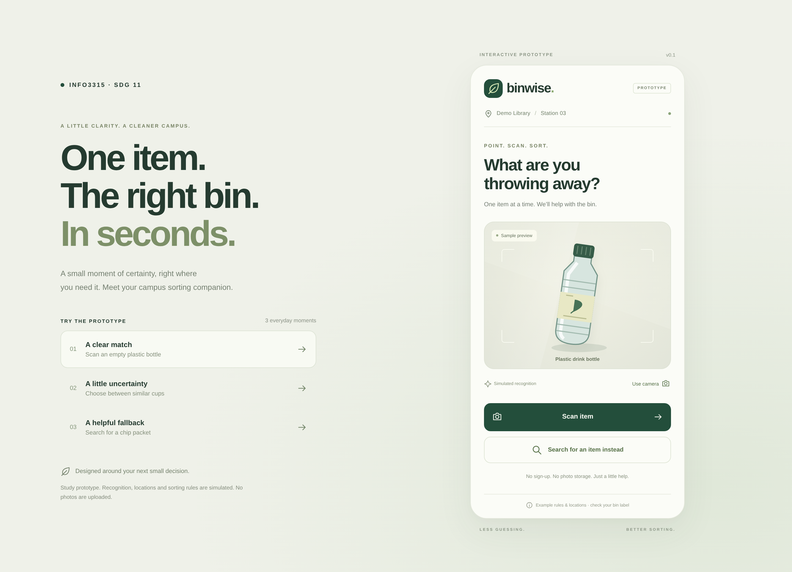

# Binwise · INFO3315 prototype

根据小组 Part I 的 **Smart Scanner** 概念制作的手机优先交互原型：二维码携带站点信息，进入扫描界面，展示明确匹配、候选选择或手动搜索。无需登录，没有多余导航。

**原型边界：** 图像识别为预设模拟，不会分析真实相机画面；地点、垃圾桶颜色、规则和退瓶点均为测试示例，未经学校或承包商确认。页面明确标注 Prototype / Simulated recognition。相机只在本机预览，不上传或保存照片。

## 查看和下载



- [下载网页源码 ZIP](https://github.com/XYD-PIXEL/3315/raw/refs/heads/main/deliverables/binwise-web-prototype.zip)
- [下载 Figma 素材 ZIP](https://github.com/XYD-PIXEL/3315/raw/refs/heads/main/deliverables/binwise-figma-kit.zip)
- [查看原型页面 PDF](deliverables/prototype-screens.pdf)
- [查看三个测试任务 PDF](deliverables/user-tasks.pdf)

也可以点击仓库右上方 **Code → Download ZIP** 下载整个项目。私有仓库需要先登录有访问权限的 GitHub 账号。

## 运行

需要 Node.js 22.12+ 或 24。当前云环境使用 Node.js 24。

解压源码 ZIP 后，在包含 `package.json` 的文件夹中打开终端（源码包内为 `binwise`，整个仓库 ZIP 内通常为 `3315-main`），运行：

```bash
npm ci
npm run dev
```

在自己电脑的浏览器中打开终端显示的 Local 地址。云环境仓库路径是 `/workspace/3315`；云环境安装时使用 `npm ci --cache /tmp/binwise-npm-cache`，启动使用 `npm run dev -- --port 5173 --strictPort`。

手机端没有登录或欢迎页，直接进入扫描。桌面左侧的三个场景按钮和手机页面下方折叠的 Prototype scenarios 是主持人演示控件，不是产品导航。

```bash
npm run build
npm test
```

浏览器测试优先使用当前环境的 `/usr/bin/chromium`。其他电脑先运行 `npx playwright install chromium`；自定义浏览器可通过 `PLAYWRIGHT_CHROMIUM_EXECUTABLE_PATH` 指定。CI 可用 `npx playwright install --with-deps chromium` 安装系统依赖。

## 三条核心流程

| 场景       | 入口参数                                 | 预设物品     | 流程                                                          |
| ---------- | ---------------------------------------- | ------------ | ------------------------------------------------------------- |
| 明确匹配   | `?station=library-03&scenario=confident` | 空塑料饮料瓶 | Scan item → Recycling → handling note → Got it                |
| 不确定匹配 | `?station=library-03&scenario=ambiguous` | 外带咖啡杯   | Scan item → 三个候选 → 选择纸质内衬杯 → General waste         |
| 搜索后备   | `?station=library-03&scenario=unknown`   | 薯片包装     | Scan item → 未识别 → 搜索 chips → Chip packet → General waste |

二维码只需编码已部署地址及 `station` 参数。`library-03` 和 `food-court-01` 都是虚构测试站点。输入未知 station 会明确报错，不会偷偷使用默认站点。食物垃圾在没有 organics 桶的站点不会被改分类到另一个桶。

**相机：** 默认提供可重复测试的插画样例。Use camera 会请求真实相机权限，必须通过 HTTPS 或本机回环地址访问。即使启用真实相机，识别结果仍取决于主持人选择的场景；不要把这个版本用于测试 AI 准确率。`camera=live` 可用于模拟扫码后自动请求相机；权限被拒绝时仍可用样例和搜索。离开扫描页面会关闭相机流。

## Figma 与课程展示

课程文档 Task 6c 指定 Figma；本仓库中的网页原型是设计和评估的参考实现。**导入素材不等于已建立 Figma 交互。** 小组仍需按 [Figma 操作指南](docs/FIGMA_GUIDE.md) 在 Figma 中连线、测试并取得真实分享链接。

- `deliverables/figma/`：390 px 宽的 SVG 页面素材，可编辑形状和文本，以及 PNG 预览。
- `deliverables/binwise-figma-kit.zip`：页面素材、PDF 与设计/测试说明合集。
- `deliverables/binwise-web-prototype.zip`：网页源码压缩包，解压后按上述运行步骤操作。
- `deliverables/prototype-screens.pdf`：原型页面合集，适合小组评审；提交前应根据最终 Figma 版本更新。
- `deliverables/user-tasks.pdf`：三个用户任务，英文参与者版。
- [测试计划](docs/USABILITY_TESTING.md)：主持人操作、测量指标、空白记录模板。
- [设计依据](docs/DESIGN_RATIONALE.md)：Part I 发现与页面设计之间的对应。

更新页面素材：先启动开发服务器，再运行：

```bash
node scripts/export-prototype.mjs
python3 scripts/export-documents.py
```

第二个命令需要 Python 的 Pillow 和 reportlab（云环境已提供；其他电脑可在虚拟环境中安装）。网页只需 npm，无需 Python。

## 后续应由小组确认

1. 与设施部门核实真实垃圾桶类别、颜色、处理提示、站点编号和位置。
2. 在 Figma 中完成交互连线，取得分享链接；真实用户应为组外的三位典型用户。
3. 按测试计划记录实际表现与问题，再迭代；当前没有虚构用户测试数据。
4. 如要提供可扫码的线上网址，需要部署到你们选择的 HTTPS 主机。当前未部署、未创建 Figma 文件。

网页原型不需要 API key、数据库或任何外部服务。页面素材由脚本生成，依赖由 `package-lock.json` 锁定。
